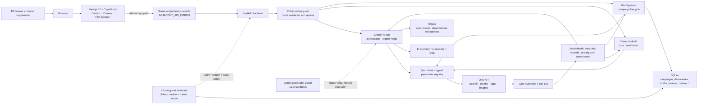
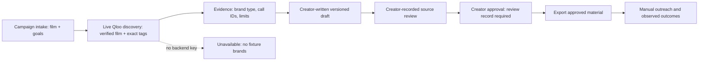

# Adjacent Cinema

**A cultural field guide for the decisions independent cinema cannot make from
box office data alone.**

Independent filmmakers and cinema programmers often have to decide _where a film
belongs, what cultural territory it might speak to, and what to test next_ with
scattered evidence and hard-won intuition. Adjacent Cinema makes those questions
investigable: start with films and themes, inspect cultural relationships
returned by Qloo, preserve the evidence and uncertainty, then turn a
creator-reviewed interpretation into a testable decision.

Qloo is central because it supplies the cultural-affinity evidence—relationships
among entities, tags and interests—that a generic text generator cannot
substantiate. Adjacent does not ask a language model to invent those
relationships. Deterministic application logic validates inputs, resolves film
identity, applies bounds, records provenance and keeps evidence separate from
interpretation. Qloo affinity is **not** audience size, viewing probability,
attendance, conversion, sponsorship willingness, eligibility, revenue or ROI.

> **No verified public demo URL is available.** Run the labelled fixture
> experience locally; it is deliberately distinct from a live Qloo analysis.

## What you can explore

- **Creator Mode** (`/creator`) — investigate cultural positioning for a film
  using Qloo evidence or explicitly labelled offline fixtures. Review an
  explainable Programme Bet and Test Card, then save a planned experiment,
  record observations and evaluate the hypothesis.
- **Cinema Mode** (`/cinema`) — enter a venue, city and programme to investigate
  cultural adjacencies and a possible next programming experiment. The fixture
  route is labelled; a live run requires a backend Qloo key.
- **FilmSponsor** (`/creator/sponsor`) — create a campaign, run live Qloo brand
  discovery, write/version sponsorship drafts, record a creator-performed source
  review, approve a draft, export approved material and manually record outreach
  and outcomes. Without a Qloo key, discovery is unavailable; no fixture brands
  or affinity scores are substituted. Source-review records are user-entered
  evidence, not an independent platform verification. Outreach metrics are
  recorded observations, not model predictions.

The product is intended to move from **cultural evidence → creator judgment → a
decision or experiment → observed learning**. It does not claim that an affinity
signal predicts a commercial outcome.

## Try the labelled offline demo

The repository contains no verified hosted application URL. Run the application
locally using [the developer guide](qloo_hackathon/adjacent/README.md), then:

1. Open `http://localhost:3000/creator?demo=fixture` for a labelled fixture run,
   or select **View labelled fixture demo (offline)** in Creator Mode.
2. Open `/cinema` and select its labelled offline fixture option.
3. Open `/creator/sponsor` to inspect the campaign workflow. With no Qloo key,
   live brand discovery returns an unavailable response; other campaign records
   are local workspace data.

Fixture output is not live Qloo data and must not be described as measured. A
failed live request never silently falls back to fixtures.

## How it works



The browser calls only relative `/api` URLs. Next.js rewrites them server-side
to the FastAPI service, keeping the Qloo credential out of browser code. The
backend's `QlooClient` validates typed request parameters, calls Qloo, and
records call provenance. `EntityResolver` checks title/year and external-ID
consistency before an entity is usable. Application code then applies evidence
thresholds, deterministic analysis and product rules; Qloo supplies evidence,
not the final recommendation or business decision.

Creator and Cinema run results are process-local/in-memory and streamed with
Server-Sent Events. Creator experiments and their observations/evaluations
persist in SQLite. FilmSponsor campaigns and their child records also use
SQLite. Optional LLM synthesis is separate and provider-gated; it can render an
existing investigation into prose, but does not execute Qloo tools or replace
deterministic validation.

### FilmSponsor workflow



The application stores the creator's source-review verdict; it does not crawl or
certify the source. The approval step requires a review record, not proof that
the commercial claim is true. Outreach, replies, meetings and outcomes are
entered by the user. A missing metric remains missing; an observed zero remains
zero.

## Architecture and repository map

- `qloo_hackathon/adjacent/frontend/` — Next.js UI, TypeScript API adapter,
  same-origin rewrite and pages.
- `qloo_hackathon/adjacent/backend/app/api/` — FastAPI run, Creator, experiment,
  FilmSponsor and optional YouTube routes.
- `qloo_hackathon/adjacent/backend/app/qloo/` — Qloo client, typed models,
  parameter validation and call tracing.
- `qloo_hackathon/adjacent/backend/app/resolution/` — film/entity identity
  checks, including title/year/ID consistency.
- `qloo_hackathon/adjacent/backend/app/agent/` — bounded orchestration, budgets
  and stop logic.
- `qloo_hackathon/adjacent/backend/app/domain/` — evidence, investigation,
  experiment, FilmSponsor, synthesis and repository logic.
- `qloo_hackathon/adjacent/backend/tests/` — fixture and security tests.
- `qloo_hackathon/adjacent/scripts/` — Qloo probe and FilmSponsor live gate.
- `qloo_hackathon/adjacent/docs/` — API contract, Qloo setup, architecture
  decisions and validation notes.

Useful references: [Developer guide](qloo_hackathon/adjacent/README.md) ·
[Frontend/API contract](qloo_hackathon/adjacent/docs/FRONTEND_CONTRACT.md) ·
[Qloo setup](qloo_hackathon/adjacent/docs/QLOO_SETUP.md) ·
[Deployment topology proposal (not deployed)](qloo_hackathon/adjacent/docs/adr/006-deployment-topology.md)
· [Live-Qloo checklist](qloo_hackathon/adjacent/docs/NEXT_LIVE_CHECKLIST.md) ·
[Environment example](qloo_hackathon/adjacent/.env.example).

## Quick start

**Prerequisites:** Python **3.12+** (declared backend minimum), Node.js **22**
(the CI runtime), and npm. A Qloo key is not required for fixture runs or the
fixture-backed test suite.

From the repository root, prepare and start the backend in Terminal 1:

```bash
cd qloo_hackathon/adjacent
python3.12 -m venv .venv
source .venv/bin/activate
python -m pip install -e '.[dev]'
cp .env.example .env
# Edit .env only if needed; keep all credentials out of Git.
set -a && . ./.env && set +a
make run
```

The example file leaves `QLOO_API_KEY` empty. Sourcing it exports configuration
to the shell; the backend does not load `.env` automatically. For no-key use,
the backend stays in mock mode, while the explicit `/run/demo` and
`/creator/run/demo` routes use labelled fixtures.

Start the frontend in Terminal 2:

```bash
cd qloo_hackathon/adjacent/frontend
npm ci
ADJACENT_API_ORIGIN=http://127.0.0.1:8000 npm run dev -- --hostname 0.0.0.0
```

Open `http://localhost:3000`. `ADJACENT_API_ORIGIN` is read by the Next.js
server and must not be placed in a `NEXT_PUBLIC_*` variable.

For secure live-Qloo configuration, supply `QLOO_API_KEY` to the **backend
process only**, preferably through an approved secret manager. The default
client host is `https://hackathon.api.qloo.com`; use the authorized Qloo
environment, not staging or production with a hackathon key. See
[Qloo setup](qloo_hackathon/adjacent/docs/QLOO_SETUP.md). Never paste a real key
into a README, browser variable, issue or chat.

## Configuration reference

The complete checked-in example is
[`qloo_hackathon/adjacent/.env.example`](qloo_hackathon/adjacent/.env.example).
Principal settings:

- `QLOO_API_KEY`: backend-only secret; absent/blank means mock mode.
- `QLOO_BASE_URL`, `QLOO_TRUSTED_BASE_URL`: Qloo/harness hosts; default to the
  hackathon API host.
- `ADJACENT_API_ORIGIN`: Next.js server proxy destination; local default is
  `http://127.0.0.1:8000`.
- `ADJACENT_EXPERIMENTS_DB`: optional SQLite path override; default is
  `data/processed/experiments.db` under the adjacent project.
- `ADJACENT_PUBLIC_DEMO`: public guard; leave unset for local development.
- `ADJACENT_PUBLIC_LIVE`: additional public live-Creator opt-in; also needs the
  backend Qloo key.
- `ADJACENT_FILMSPONSOR_GUEST_DEMO`: separate guest opt-in; also needs public
  mode and valid origins.
- `ADJACENT_FILMSPONSOR_GUEST_ORIGINS`: comma-separated exact frontend origins;
  wildcard is not accepted. HTTP is localhost-only.
- `ADJACENT_FILMSPONSOR_GUEST_COOKIE_SECURE`: defaults to `1`; disable only for
  explicit localhost HTTP development.
- `ADJACENT_LLM_API_KEY`: optional backend credential for LLM synthesis only;
  not needed for Qloo analysis.

Other probe timeouts, retry/rate settings, optional YouTube OAuth settings and
optional synthesis base URL/model are documented in source and/or the linked
example. Do not configure provider credentials in frontend variables.

## Tests and current status

From `qloo_hackathon/adjacent`:

```bash
make test          # pytest; no Qloo key required
make lint          # Ruff
make ci            # lint + tests
make probe         # dry-run/mock probe; no Qloo request
```

From `qloo_hackathon/adjacent/frontend`:

```bash
npm ci
npx tsc --noEmit
npm run build
```

**Verified status:** the latest checked GitHub Actions run for `main` at
`48f36bb` passed the Python 3.12 backend job and Node 22 frontend build. Its
conditional live-Qloo step was **skipped**, not passed. No live-Qloo validation,
real-browser isolation check, or hosted deployment is claimed here. The
[CI workflow](.github/workflows/ci.yml) is the source for the current gates;
check its latest run before relying on this snapshot.

## Security, limitations and deployment status

- **Local development is single-user, not authentication.** Leave
  `ADJACENT_PUBLIC_DEMO` unset locally. Do not expose the ordinary local API
  directly to the internet.
- With `ADJACENT_PUBLIC_DEMO=1`, the public guard allows bounded labelled
  fixture runs and a limited Creator surface; it blocks shared experiment
  reads/writes, YouTube access/writes, synthesis, debug and API documentation.
  Live Creator is separately gated by `ADJACENT_PUBLIC_LIVE=1` plus a backend
  key. Public request limits include 120 requests per observed peer IP/minute,
  2,400 per process/minute and 64 in flight. These process-local controls
  require an edge/gateway quota when exposed; a proxy may make users share an
  API-observed IP bucket.
- FilmSponsor remains blocked in public mode unless
  `ADJACENT_FILMSPONSOR_GUEST_DEMO=1` is also set and valid exact origins are
  configured. Guest sessions last **eight hours**, use an HttpOnly bearer cookie
  plus a CSRF header and Origin checks for writes, and scope every campaign tree
  to the server-generated owner. Storage and request caps are enforced in the
  SQLite-backed guest path. See the
  [guest-mode contract](qloo_hackathon/adjacent/docs/FRONTEND_CONTRACT.md).
- **Retention is not scheduled:** expired sessions are rejected, and cleanup is
  triggered opportunistically by session activity/cleanup calls. If the service
  remains idle, expired session and campaign rows can remain in SQLite beyond
  the eight-hour authentication lifetime. Revocation deletes the session's
  campaign tree. No background cleanup service or guaranteed deletion deadline
  is implemented.
- SQLite uses WAL and is a **single-host local-filesystem** design. Do not put
  it on a network filesystem or use independent replica copies. A single backend
  process is the conservative baseline; the in-process public limiter is not
  shared across workers. Use durable storage, restrictive file/backup access,
  encrypted storage as required by the operator, TLS, ingress log redaction and
  external rate limits before any public exposure.
- No OCI configuration, deployment record, HTTPS endpoint or public application
  URL has been verified. Do not describe the app as deployed, production-ready
  or multi-tenant.

## Live checks and useful documentation

After an authorized key is configured securely in the backend environment, the
general live Qloo probe is `make probe-live` (from `qloo_hackathon/adjacent`).
The FilmSponsor-specific live gate is `python scripts/filmsponsor_live_gate.py`
from that same directory; it requires `QLOO_API_KEY` and makes real Qloo
requests. Do not run either command as a fixture test. Review results as
measured evidence and preserve the command's status/output without publishing
secrets. No live command has been run as part of this README update.

- [Qloo setup and endpoints](qloo_hackathon/adjacent/docs/QLOO_SETUP.md)
- [Current live-Qloo checklist](qloo_hackathon/adjacent/docs/NEXT_LIVE_CHECKLIST.md)
- [Historical live observations (not current validation)](qloo_hackathon/adjacent/docs/LIVE_QLOO_VALIDATION.md)
- [API and frontend contract](qloo_hackathon/adjacent/docs/FRONTEND_CONTRACT.md)
- [Deployment topology proposal](qloo_hackathon/adjacent/docs/adr/006-deployment-topology.md)

## License and contributions

The project is licensed under the [MIT License](LICENSE). There is no separate
contribution guide in this repository; use GitHub issues or pull requests for
proposed changes. Do not include API keys, private film material or personal
data in commits or issue reports.
