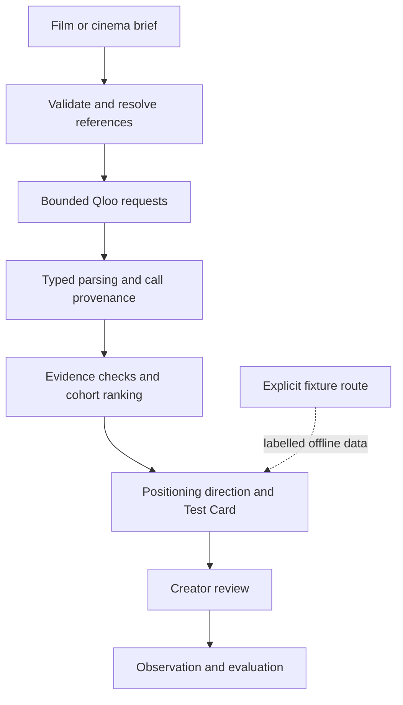

# Adjacent Cinema

<p align="center">
  <strong>Cultural intelligence for independent cinema.</strong><br />
  Explore the cultural worlds around a film, inspect the evidence, and turn a positioning idea into a testable decision.
</p>

<p align="center">
  <a href="https://adjacent-cinema.vercel.app"><strong>Live application</strong></a>
  · <a href="https://github.com/Sohamgaonkhadkar/adjacent-cinema">Source code</a>
  · <a href="qloo_hackathon/adjacent/README.md">Developer guide</a>
</p>

<p align="center">
  <a href="https://github.com/Sohamgaonkhadkar/adjacent-cinema/actions/workflows/ci.yml"></a>
  
  
  
  <a href="LICENSE"></a>
</p>

Adjacent Cinema is a Qloo-powered decision-support product for independent filmmakers and cinema programmers. It helps people investigate cultural adjacency beyond genre labels and familiar comparables, understand why a result appeared, and decide what is worth testing next.

It was built for the **2026 Qloo Agentic Hackathon** around a simple principle: cultural affinity can inform a creative decision, but it should never be presented as proof of audience demand.

> **Important distinction:** Qloo affinity is a cultural-similarity signal. It is not audience size, viewing probability, attendance, conversion, sponsorship likelihood, revenue or return on investment.

---

## The product

**Start here:** [adjacent-cinema.vercel.app](https://adjacent-cinema.vercel.app)

| Workspace | What it helps you do |
|---|---|
| **Creator Studio** · [/creator](https://adjacent-cinema.vercel.app/creator) | Enter a film brief, comparable works and themes; inspect resolved references, cultural cohorts, a Cultural Fingerprint, positioning directions and an evidence-linked Test Card. |
| **Cinema Mode** · [/cinema](https://adjacent-cinema.vercel.app/cinema) | Explore cultural adjacencies around a venue and its programme, then challenge the proposed programming direction against alternative ranking conditions. |
| **FilmSponsor** · [/creator/sponsor](https://adjacent-cinema.vercel.app/creator/sponsor) | Run brand discovery, inspect evidence, create and version campaign drafts, review sources, approve material and record outreach outcomes. |

### From cultural signals to a decision

1. **Describe the context.** Provide a film or programme, comparable titles, themes and optional release or venue details.
2. **Resolve identities.** Verify film and tag references before they enter the analysis. Unresolved or conflicting references remain unresolved; they are not guessed.
3. **Explore adjacent worlds.** Use Qloo search, entity, tag and insights capabilities to retrieve cultural signals and candidate cohorts.
4. **Inspect the result.** Review ranked and rejected cohorts, provider call provenance, the Cultural Fingerprint and the reasoning behind a proposed direction.
5. **Challenge the recommendation.** Compare the full ranking with affinity-withheld and popularity-only conditions over the same candidate pool.
6. **Make it testable.** Convert a supported direction into an editable Test Card, then record observations and evaluate the hypothesis as supported, contradicted or inconclusive.

### What makes it different

- **Cultural Multiverse:** compare evidence-backed ANCHOR, BRIDGE and FRONTIER positioning directions. Unsupported directions remain unavailable rather than being invented to fill the interface.
- **Decision Challenge / Impact Lab:** compare the full, affinity-withheld and Qloo-popularity-only rankings over the same Qloo-discovered candidate pool. See the run-level inference and candidate-by-candidate rank movement. This measures within-pool sensitivity, **not** a Qloo-versus-no-Qloo effect or recommendation accuracy.
- **Evidence with provenance:** claims, cohorts and explanations retain references to the Qloo calls that produced them. Facts, interpretations, hypotheses and unknowns are kept distinct.
- **Human review stays in the loop:** FilmSponsor drafts and source reviews require creator action; discovery is not treated as proof of sponsorship fit.
- **A learning loop, not an oracle:** proposed decisions can be saved, observed and evaluated. Missing or incomparable measurements remain inconclusive.

---

## How the agent works

Adjacent uses a deliberately bounded agentic workflow. A Python controller follows a finite `PLAN → SELECT → ACT → EVALUATE → STOP` state machine with typed tools, request budgets, evidence gates and explicit stop conditions.

It is **not** a free-running LLM agent. Qloo retrieval and the core decision logic are controlled by application code. Optional LLM synthesis is downstream of a completed investigation and is disabled in the current public-demo configuration.



### Engineering principles

- **Identity before affinity:** conflicting title, year or external-ID signals are not allowed to silently resolve to a convenient entity.
- **Typed provider boundary:** endpoint parameters and response shapes are validated at the Qloo client boundary.
- **Bounded execution:** tool calls, candidate sets and optional explainability are capped; the controller has explicit stop behaviour.
- **No silent fixture fallback:** fixture output is selected explicitly and labelled. A failed live request does not become a successful-looking fixture result.
- **Honest insufficiency:** rejected cohorts, missing values and unsupported conclusions remain visible.
- **Traceable decisions:** the analysis result and Test Card retain the evidence and provenance needed to inspect how a recommendation was formed.

---

## Architecture and technology

| Layer | Implementation |
|---|---|
| Frontend | Next.js 16 App Router, React 19, TypeScript 5.9 |
| API | Python 3.12+, FastAPI, Pydantic, HTTPX and Uvicorn |
| Cultural intelligence | Qloo API with typed request validation, entity resolution and call tracing |
| Agent orchestration | Explicit Python state machine, deterministic ranking and evidence gates |
| Data | SQLite for experiment and FilmSponsor records; process-local memory for active run/SSE state |
| Visualization | Custom React interfaces, Cultural Fingerprint, Cultural Multiverse and MapLibre |
| Quality | Pytest, Ruff, Node test runner, TypeScript, Next.js production build and Docker builds |
| Optional adapter | Read-only MCP server over stdio; live use is separately gated |

The browser calls same-origin `/api/*` routes. Next.js proxies requests to the FastAPI service, keeping the Qloo credential on the backend. The provider key must never be placed in a `NEXT_PUBLIC_*` variable or committed to the repository.

---

## Run locally

### Requirements

- Python 3.12+
- Node.js 22 and npm
- Git
- A Qloo API key only for live Qloo requests; fixture mode and offline tests do not require one

### 1. Start the backend

From the repository root:

```bash
cd qloo_hackathon/adjacent
python3.12 -m venv .venv
source .venv/bin/activate
python -m pip install --upgrade pip
python -m pip install -e '.[dev]'

# Do not overwrite an existing local environment file.
test -f .env || cp .env.example .env
set -a
. ./.env
set +a

make run
```

The API starts on `http://127.0.0.1:8000`. The backend reads environment variables; it does not automatically load `.env`.

### 2. Start the frontend

In a second terminal:

```bash
cd qloo_hackathon/adjacent/frontend
npm ci
ADJACENT_API_ORIGIN=http://127.0.0.1:8000 npm run dev -- --hostname 0.0.0.0
```

Open [http://localhost:3000](http://localhost:3000).

### Try the labelled fixture

- [Creator fixture demo](https://adjacent-cinema.vercel.app/creator?demo=fixture) — deterministic offline example, not live Qloo data.
- Locally: `http://localhost:3000/creator?demo=fixture`.

For Windows PowerShell commands, complete configuration, API contracts, test commands and deployment options, use the [developer guide](qloo_hackathon/adjacent/README.md).

### Live Qloo configuration

Set `QLOO_API_KEY` in the backend process environment only. Use the authorized API host/key pairing for your environment. The checked-in `.env.example` is a template; a healthy `/health` response confirms backend health and configuration flags, not that a future upstream Qloo request will succeed.

---

## Production deployment and current verification

- **Frontend:** [Vercel production site](https://adjacent-cinema.vercel.app)
- **Backend:** [Render API](https://adjacent-cinema.onrender.com)
- **Backend health:** [direct `/health`](https://adjacent-cinema.onrender.com/health) · [same-origin `/api/health`](https://adjacent-cinema.vercel.app/api/health)

**Verified 2 November 2026:** the application release checked during this verification is [`c353521`](https://github.com/Sohamgaonkhadkar/adjacent-cinema/commit/c35352115617ba8fec66664cf2a48a3d64d6d029). The main-branch CI run for that release, [41431186032](https://github.com/Sohamgaonkhadkar/adjacent-cinema/actions/runs/41431186032), passed the backend, frontend and container-build jobs. Vercel reported the production deployment as READY and Render reported the backend deployment as LIVE. The main product routes rendered successfully; direct Render `/health` and proxied Vercel `/api/health` both returned HTTP 200 after the backend had recovered.

The final reliability work is recorded in:

- [PR #31 — Render cold-start recovery](https://github.com/Sohamgaonkhadkar/adjacent-cinema/pull/31)
- [PR #32 — shared backend readiness across workflows](https://github.com/Sohamgaonkhadkar/adjacent-cinema/pull/32)

**Cold-start note:** the hosted backend uses Render's free tier and may sleep after inactivity. The frontend now shares and retries idempotent health checks before guarded API operations, for up to 150 seconds, and shows connection/retry state. Only the health `GET` is retried; analysis and other write requests are not automatically replayed. The first request after sleep can still be slow or temporarily return 503. This improves recovery but is not an uptime guarantee.

---

## Current limitations

- Cultural affinity is a discovery signal, not proof of audience demand or commercial outcomes.
- Optional LLM synthesis and shared experiment-owner APIs are disabled in the public-demo configuration.
- Active run and SSE state are in memory and can be lost on a backend restart. SQLite-backed records depend on the host's storage lifecycle and are not a distributed multi-tenant data layer.
- The hosted public demo is a bounded demonstration, not a security-certified production multi-tenant service.
- A successful health check or passing CI run does not prove that every live Qloo call, browser interaction or future deployment will succeed.

---

## Developer documentation

| Document | Contents |
|---|---|
| [Developer guide](qloo_hackathon/adjacent/README.md) | Environment setup, local development, tests, configuration and operational notes |
| [Qloo setup](qloo_hackathon/adjacent/docs/QLOO_SETUP.md) | Provider configuration and live request checks |
| [Frontend/API contract](qloo_hackathon/adjacent/docs/FRONTEND_CONTRACT.md) | API payloads, events, evidence fields and lifecycle rules |
| [Deployment runbook](qloo_hackathon/adjacent/docs/DEPLOYMENT.md) | Docker Compose, Caddy and Render Blueprint options |
| [Live-Qloo checklist](qloo_hackathon/adjacent/docs/NEXT_LIVE_CHECKLIST.md) | Dated validation evidence and remaining operational gates |
| [Decision Challenge design](qloo_hackathon/adjacent/docs/adr/007-decision-challenge.md) | Counterfactual ranking methodology |
| [November Impact Lab audit](qloo_hackathon/adjacent/docs/IMPACT_LAB_COMPETITOR_AUDIT_20261102.md) | Competitor lessons, observed negative findings, known evaluation limits and next experiments |
| [MCP server guide](qloo_hackathon/adjacent/docs/MCP_SERVER.md) | Optional read-only MCP adapter |

## License

Released under the [MIT License](LICENSE).
