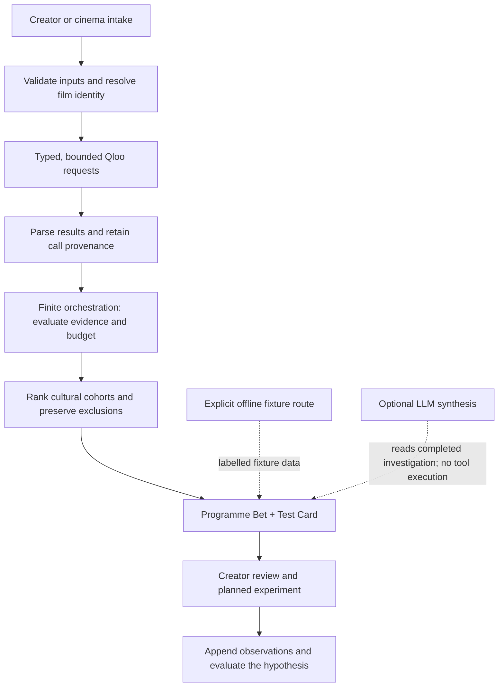
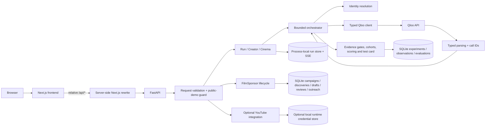

# Adjacent Cinema

<p align="center">
  <strong>Cultural intelligence for independent cinema.</strong><br />
  Turn a film or programme into an inspectable cultural field—and a hypothesis worth testing.
</p>

<p align="center">
  <a href="https://github.com/Sohamgaonkhadkar/adjacent-cinema/actions/workflows/ci.yml"></a>
  
  
  
  <a href="LICENSE"></a>
</p>

Adjacent Cinema is a decision-support workspace for independent filmmakers and cinema programmers. It helps answer three connected questions:

1. **Where might this film belong culturally?**
2. **Which relationships are supported by evidence, and which remain uncertain?**
3. **What small, observable experiment should we run next?**

Rather than turning a synopsis into an unsupported audience prediction, Adjacent combines Qloo cultural-affinity evidence, verified entity resolution, bounded deterministic analysis, explicit provenance and creator judgment. Its central deliverable is not a promise of success—it is a decision that can be inspected, challenged, tested and learned from.

> **Evidence rule:** Qloo affinity is a cultural-similarity signal. It is not audience size, viewing probability, attendance, conversion, sponsorship willingness, revenue or return on investment.

> **Live application:** [adjacent-cinema.vercel.app](https://adjacent-cinema.vercel.app). The production Next.js frontend is deployed on Vercel and routes API requests to the FastAPI backend on Render ([health endpoint](https://adjacent-cinema.onrender.com/health)). Live Qloo integration runs through the backend; `QLOO_API_KEY` must remain in the backend environment and is never exposed to browser code. Fixture experiences are explicitly labelled and are not used as a silent fallback when live requests fail.


## Fit to the Qloo Agentic Hackathon

The [official challenge](https://qloo.devpost.com/) asks for a working Qloo-integrated application that functions as an agentic tool, uses an agent framework, or integrates Qloo into an existing agent. Judging emphasizes **technological implementation, design, potential impact, and quality of the idea**.

Adjacent is a **bounded agentic decision-support tool** for independent filmmakers and cinema programmers. Its controller follows an explicit `PLAN → SELECT → ACT → EVALUATE → STOP` state machine, with budgets, typed tool results, evidence gates and recorded provenance. It is deterministic orchestration, **not a claim of a free-running LLM agent**. Optional LLM synthesis is disabled in the current public-demo environment; the core workflow uses Qloo and controlled application logic.

| Hackathon concern | How Adjacent addresses it |
|---|---|
| Genuine Qloo integration | Verified film/entity lookup, theme-tag resolution, taste-profile insights, cross-domain candidate expansion and cohort scoring use Qloo's API. Calls are traced; live results carry `data_status: "measured"`. |
| A complete product experience | Creator Mode, Cinema Mode and FilmSponsor connect cultural evidence to inspectable results and a next-step decision or experiment. |
| A specific real-world problem | Helps independent filmmakers and programmers explore cultural adjacencies without pretending that affinity predicts attendance, sponsorship willingness or revenue. |
| Originality and thoughtful use | The Decision Challenge tests ranking sensitivity against counterfactuals using the same retrieved pool; it does not add new Qloo calls or invent ground truth. |

### Suggested judge walkthrough

1. Open [Creator Mode](https://adjacent-cinema.vercel.app/creator). Enter a working title, then add **real, resolvable reference films** with their years and a small number of themes. Run the live analysis and inspect the source/evidence trace, ranked cultural worlds, Cultural Multiverse and Test Card.
2. Open [Cinema Mode](https://adjacent-cinema.vercel.app/cinema) to explore a venue/programme and inspect the Decision Challenge. Interpret the result as cultural evidence for a testable programming hypothesis—not an audience forecast.
3. Open [FilmSponsor](https://adjacent-cinema.vercel.app/creator/sponsor) to start a guest workspace, create a campaign and request live brand discovery. Review each brand and source yourself; the app does not establish sponsorship likelihood, eligibility or ROI.
4. Use the [labelled fixture demo](https://adjacent-cinema.vercel.app/creator?demo=fixture) only to show the offline experience. Fixture output is illustrative and must never be presented as live Qloo evidence.

### Production verification snapshot — 27 October 2026

- The production routes `/`, `/creator`, `/cinema` and `/creator/sponsor` returned HTTP 200 in a route smoke check. This confirms server-rendered route availability, **not** every click path or browser-security property.
- `/api/health` returned HTTP 200 with `mode: "public_demo"`, `fixture_demo_available: true`, `live_creator_available: true` and `filmsponsor_guest_enabled: true`.
- Sampled production Creator and Cinema runs completed with `status: "completed"`, `stop_reason: "complete"` and `data_status: "measured"`. Their inspected Qloo trace entries returned HTTP 200.
- Render logs show successful FilmSponsor guest-session, campaign-list/create and brand-discovery requests on 26 October. Earlier logs also recorded guest-origin mismatches, so verify the exact stable frontend origin and cookie/CSRF flow in a normal browser before relying on that path for judging.
- `/api/creator/synthesis-status` reports synthesis unavailable because optional synthesis is disabled in public-demo mode. `/api/experiments` returning HTTP 403 is intentional public-demo policy, not a broken page.

The [live counterfactual evaluation](qloo_hackathon/adjacent/docs/verification/live_counterfactual_evaluation.md) is intentionally presented without spin: the affinity-withheld run changed the winner in **0/3** measured programmes, while the popularity-only baseline changed it in **3/3**. These samples show a difference from that baseline, but **do not prove that affinity-derived ordering is necessary or decisive**. Do not claim attendance lift, audience size, causality or ROI.

---

## Contents

- [Product at a glance](#product-at-a-glance)
- [Explore the product](#explore-the-product)
- [The analysis pipeline](#the-analysis-pipeline)
- [What makes the engineering different](#what-makes-the-engineering-different)
- [Technology stack](#technology-stack)
- [Architecture](#architecture)
- [Repository map](#repository-map)
- [Local setup](#local-setup)
- [Fixture mode versus live Qloo](#fixture-mode-versus-live-qloo)
- [API surface](#api-surface)
- [Data, storage and lifecycle](#data-storage-and-lifecycle)
- [Configuration](#configuration)
- [Tests and CI](#tests-and-ci)
- [Deployment guide](#deployment-guide)
- [Security and known limitations](#security-and-known-limitations)
- [Documentation map](#documentation-map)
- [License and contribution notes](#license-and-contribution-notes)

## Product at a glance

| Surface | Route | What it is for |
|---|---|---|
| **Creator Mode** | `/creator` | Investigate a film's cultural position from comparable works, themes, release context and optional geography. Inspect ranked cultural worlds, the reasoning behind a Programme Bet, and a Test Card. |
| **Cinema Mode** | `/cinema` | Explore cultural adjacencies around a venue and its programme, then frame a possible programming experiment. |
| **FilmSponsor** | `/creator/sponsor` | Work through campaign intake, live Qloo brand discovery, editable/versioned sponsorship drafts, creator-entered source reviews, approval, export, outreach and manually recorded outcomes. |
| **Home / product introduction** | `/` | Understand the product and enter Creator or Cinema workflows. |
| **Offline fixture experience** | `/creator?demo=fixture` | Explore a clearly labelled, deterministic Creator demonstration without a Qloo key. |

### The user journey

**Cultural evidence → creator interpretation → a bounded decision → an experiment → observed learning.**

The application keeps those steps connected without pretending they are interchangeable. Evidence is not interpretation; interpretation is not outcome; and missing measurements are not filled with invented numbers.

### Start with the demo

To try the deployed product, start at [the live application](https://adjacent-cinema.vercel.app). For local development, after [running locally](#local-setup), open:

- `http://localhost:3000/creator?demo=fixture` — labelled Creator fixture demo
- `http://localhost:3000/cinema` — Cinema Mode; choose its explicit fixture option
- `http://localhost:3000/creator/sponsor` — FilmSponsor workflow and its current configuration state

Fixture output is illustrative offline data, never a live Qloo result. Live requests do not silently fall back to fixtures.

## Explore the product

### 1. Creator Mode — from references to a testable bet

A filmmaker can enter a working title, logline, genre, language, themes, comparable works, release goal and optional target location. The workflow separates film references from thematic concepts; it resolves title/year/ID consistency before a film is admitted to the evidence pipeline.

The result can include:

- a verified/unresolved view of submitted references;
- cultural affinity signals and ranked cross-domain cohorts;
- rejected or insufficient worlds with reasons preserved;
- an interactive **Cultural Fingerprint** based on returned cohorts and their real members;
- an explainable **Programme Bet** with a primary and, where supported, runner-up direction;
- a **Test Card** with a hypothesis, evidence, a comparison protocol, a primary measure, a user-set decision rule, an observation window and a falsification condition;
- bounded **Qloo per-seed explainability** on scoring calls with at most 12 candidate entities: where Qloo returns attribution, inspect which verified reference works contributed to a scored result. Larger scoring contexts omit this optional metadata to keep response size bounded; absence is not a zero contribution;
- a lifecycle for saving the plan, recording observations and evaluating what happened;
- **Cultural Multiverse / Positioning Arena**: after a completed Creator run, compare an evidence-backed ANCHOR, a BRIDGE only when Qloo-returned shared evidence supports it, and a same-context FRONTIER only when it clears the existing evidence gate and novelty proxy. If a strategy is unsupported, it is explicitly unavailable;
- What-If priority controls reorder those unchanged candidates using source-context ordinal evidence—no new Qloo calls, no cross-query affinity comparison, and no audience forecast. A selected strategy and policy can be frozen into the existing experiment snapshot.

The fingerprint is an evidence map, not an automatic recommendation list. Selecting a node reveals its associated details; it does not assert that the named entity will attract an audience.

Where bounded scoring requests include Qloo's documented `feature.explainability`, each result may also expose Qloo's per-seed attribution weights. These are provider-returned explanations of model contribution—not causal effects, audience counts, or guarantees—and the UI keeps them linked to the scoring call. Broad contexts above the configured candidate limit omit this optional metadata to bound response size.

The Test Card now includes an experiment design rather than only a desired outcome: a suggested comparison, one primary observable measure, and an explicit instruction for the creator to set a practically meaningful decision threshold before launch. Creator tests recommend a randomized split only when the publishing platform supports it; otherwise the result must be described as exploratory. The app supplies no sample-size or success threshold, and missing or incomparable observations remain inconclusive.

### 2. Cinema Mode — programme context, not just a venue label

Cinema Mode accepts a venue, city and programme. It uses the same bounded analysis ideas to help a programmer examine neighbouring cultural worlds and formulate a possible next programming test. Geography is displayed only when the corresponding analysis step actually produced usable data.

The fixture path is visibly labelled. A live analysis requires the backend's authorized Qloo configuration.

### 3. FilmSponsor — discovery and review, with human accountability

FilmSponsor is a campaign workflow rather than a one-click sponsor recommender:

1. Create a campaign around a film and goals.
2. Run **live** Qloo brand discovery against verified film/tag signals.
3. Inspect discovery evidence, source/call references and limitations.
4. Write and version a draft.
5. Record a creator-performed review of a source.
6. Approve a draft only after the required review record exists.
7. Export the approved material.
8. Record outreach, replies and outcomes as manually observed information.

Without a Qloo key, live brand discovery is unavailable. The app does not substitute synthetic brands or affinity scores. Source-review records are entered by the creator; they are not an independent verification service. Outreach metrics are recorded observations, not model predictions.

The optional public guest workspace has separate opt-in settings, an eight-hour session, owner-scoped campaign records and write protections. It is still a bounded demo workspace, not a substitute for a full identity provider or production multi-tenant security review.

### 4. Experiment learning — keep the result attached to the decision

A Test Card can be saved as a planned experiment. The saved decision keeps its provenance snapshot; observations are appended as evidence becomes available; and evaluations record whether the hypothesis was supported, contradicted or inconclusive. A new evaluation supersedes the current evaluation without rewriting the earlier history.

Where supported by the data path, creators can record YouTube Analytics observations using an optional creator-authorized connection. That integration is a **single-connection** implementation, not a multi-user public OAuth service.

---

## The analysis pipeline

The pipeline uses Qloo as an evidence source and application logic as the controlled decision layer.



### Evidence and stopping are first-class outcomes

A run can complete, stop because evidence is insufficient, fail because a tool or upstream request failed, stop because a budget was exhausted, or reject invalid input. These states are kept distinct. An unresolved film is not quietly guessed; a missing score is not displayed as zero; a failed run does not gain a fabricated result.

The UI and export formats preserve `data_status` and provenance so a reader can distinguish illustrative fixtures from measured Qloo responses.

## What makes the engineering different

### A narrow, typed provider boundary

The backend's `QlooClient` validates endpoint-specific parameters against a registry before making requests. Unsupported or unverified parameters are rejected rather than being sent optimistically—important because an upstream service may ignore unknown parameters and return an empty-looking response.

The client covers the Qloo search, entity, tag, audience, insights, trending and compare operations represented in the checked implementation. Response parsing is typed, errors are classified, retry behavior is bounded, and calls receive traceable identifiers.

### Identity before affinity

Film references pass through identity-resolution checks that consider title/year and external-ID consistency. A conflicting identifier is not allowed to win merely because it exists, and unresolved inputs are excluded from the evidence rather than substituted with a guess. Theme concepts are resolved separately from film references and only accepted tag matches are used as theme signals.

### Explicit orchestration instead of a black-box agent loop

The orchestrator is a finite state machine with named planning, tool selection, action, evaluation and stop stages. It uses explicit phase/tool mappings, a budget and a finite loop guard. The purpose is bounded, inspectable execution and honest refusal—not autonomous exploration without a visible control path.

### Provenance follows the decision

Qloo calls, call IDs, evidence rows, ranked cohort IDs, the selected Programme Bet and the Test Card are linked. The frontend exposes trace references where available. A saved experiment keeps a snapshot of its originating decision so later events do not rewrite what was originally proposed.

### Data integrity is treated as a product feature

- A measured `0` remains different from a missing value.
- Insufficient evidence stays insufficient; it is not dressed up as a strong recommendation.
- Rejected cohorts remain inspectable with reason codes.
- Fixture results keep their fixture label through results and exports.
- Live provider failures never become fixture success.
- Test Card success criteria are observable conditions, not invented view counts, attendance targets or revenue forecasts.

### Optional synthesis is downstream and bounded

When configured, the LLM synthesis layer renders an existing investigation into a structured creator-facing brief. It does not execute Qloo tools or replace deterministic analysis. The implementation validates schema and reference integrity, constrains claims and records limitations. **Reference integrity is not a guarantee of semantic support**: deterministic validation cannot prove that a cited call truly entails every sentence. If the provider is unavailable, the synthesis surface reports that state or returns a clearly labelled deterministic fallback according to the implemented path; it does not pretend the fallback was model output.

### Fingerprint and export are functional UI, not decoration

The Cultural Fingerprint graph draws its ranked worlds and outer entities from cohort data returned by the run. It has a visible legend, inspectable nodes, keyboard interactions and an honest empty state. The Creator and Cinema Test Card interfaces provide a plain-text `.txt` export for a readable, portable decision record; the export includes the data status and an interpretation-limit note.

## Technology stack

| Layer | Technologies | Responsibility |
|---|---|---|
| Web application | Next.js 16 App Router, React 19, TypeScript 5.9 | Product routes, interactive workflows, API client and server-side same-origin proxy |
| UI and visualization | Custom CSS, Lucide React, MapLibre GL JS | Editorial layout, accessible controls, cultural graph and geographic views |
| API | Python 3.12+, FastAPI, Pydantic 2, HTTPX, Uvicorn | Typed contracts, request boundaries, workflow APIs and provider integration |
| Cultural data | Qloo API, typed response parsers, validated parameter registry | Search, identity lookup, tags and affinity/insights evidence |
| Orchestration | Explicit Python state machine, budgets, stop rules, deterministic domain logic | Bounded execution, evidence evaluation and reasoned terminal status |
| Persistent records | SQLite, append-oriented repository operations, WAL/local filesystem | Experiments, observations, evaluations and FilmSponsor campaign records |
| Optional integrations | Provider-gated LLM synthesis; YouTube OAuth/Analytics | Structured interpretation and creator-authorized measurement |
| Quality gates | Pytest, Ruff 0.17.0, Node test runner, TypeScript, Next production build, Docker | Regression coverage, linting, production route smoke tests and container builds |
| Delivery options | Render Blueprint; Docker Compose + Caddy | Managed split frontend/API deployment or a single-host HTTPS topology |

**No trained audience-prediction model is claimed.** The core product is a typed cultural-data integration, deterministic evidence pipeline and experiment lifecycle. Its value is in making cultural reasoning inspectable and testable.

---

## Architecture



The browser calls relative `/api` routes. `frontend/next.config.ts` rewrites them server-side to `ADJACENT_API_ORIGIN`; the Qloo credential remains in the backend environment, never in browser-visible `NEXT_PUBLIC_*` variables.

### Request flow

1. The API validates the request and applies the configured request boundary.
2. Identity resolution checks that submitted references are suitable for downstream use.
3. The finite orchestrator runs a bounded phase sequence through typed tools.
4. Parsers normalize Qloo responses and retain source/call references.
5. Evidence gates rank qualifying cohorts, annotate rejected worlds and decide whether a Programme Bet is supported.
6. A result, trace and Test Card are emitted through the API; run progress is available through Server-Sent Events (SSE).
7. The creator can save a planned experiment and later append observations/evaluations.

### Persistence boundaries

| Data | Storage | Operational consequence |
|---|---|---|
| Active run and SSE history | Process-local memory | Lost on backend restart; not durable run history |
| Experiments, observations and evaluations | SQLite | Durable on the configured local/persistent filesystem |
| FilmSponsor campaign tree | SQLite | Campaigns, discovery records, drafts, source reviews and outreach are persisted together |
| YouTube connection data | Optional runtime-local store | Single-owner integration; do not expose as multi-user OAuth |
| Raw provider secrets | Backend environment/secret manager | Never sent to frontend code or included in README/examples |

SQLite is a single-host, local-filesystem design. The conservative deployment model uses one backend process and one persistent volume. Do not horizontally scale this design or use a shared network filesystem without reworking the run store, quotas and database architecture.

## Repository map

```text
.
├── README.md
├── LICENSE
├── render.yaml                         # Render Blueprint (not a deployment by itself)
├── .github/workflows/ci.yml            # Backend, frontend and container CI
└── qloo_hackathon/adjacent/
    ├── pyproject.toml                  # Python package, dependencies, pytest/Ruff config
    ├── Makefile                        # Common development and verification commands
    ├── .env.example                    # Safe configuration template; no live key
    ├── compose.yaml                    # Single-host service topology
    ├── Caddyfile                       # HTTPS edge/reverse proxy for Compose
    ├── backend/
    │   └── app/
    │       ├── api/                    # Run, Creator, FilmSponsor and YouTube routes
    │       ├── agent/                  # State machine, budgets, tools and stop rules
    │       ├── domain/                 # Identity, cohorts, scoring, evidence, experiments
    │       ├── qloo/                   # Client, typed models, params and traces
    │       └── resolution/             # Film/entity identity and resolution contract
    ├── frontend/
    │   ├── app/                        # Home, Creator, Cinema and FilmSponsor screens
    │   ├── components/                 # Cultural graph, evidence trace and visual surfaces
    │   ├── lib/                        # API client, run recovery and plain-text export
    │   └── tests/                      # UI contract, responsiveness, recovery and render smoke
    ├── scripts/                        # Qloo probe and FilmSponsor live gate
    └── docs/                           # Contracts, evidence audits, setup and deployment runbooks
```

## Local setup

### Prerequisites

- Python **3.12 or newer**
- Node.js **22** and npm
- Git
- A Qloo key only for live Qloo requests; the fixture experience and ordinary test suite work without one

### 1. Start the backend

From the repository root, in Terminal 1:

```bash
cd qloo_hackathon/adjacent
python3.12 -m venv .venv
source .venv/bin/activate
python -m pip install --upgrade pip
python -m pip install -e '.[dev]'

# Create the template only if a local .env does not already exist.
test -f .env || cp .env.example .env

# The app reads environment variables; it does not load .env automatically.
set -a
. ./.env
set +a

make run
```

The backend listens on port `8000`. The checked-in `.env.example` leaves `QLOO_API_KEY` blank, so this setup does not need a live key. Never overwrite an existing `.env` simply to follow the setup instructions.

Verify the backend directly:

```bash
curl -fsS http://127.0.0.1:8000/health
```

### 2. Start the frontend

In Terminal 2:

```bash
cd qloo_hackathon/adjacent/frontend
npm ci
ADJACENT_API_ORIGIN=http://127.0.0.1:8000 npm run dev -- --hostname 0.0.0.0
```

Open `http://localhost:3000`. The server-side Next.js rewrite proxies `/api/*` to the FastAPI service.

On Windows PowerShell, set the frontend origin before running the dev server:

```powershell
$env:ADJACENT_API_ORIGIN = "http://127.0.0.1:8000"
npm ci
npm run dev -- --hostname 0.0.0.0
```

The Python environment must also be configured for the backend process; `.env` is a template, not an automatically loaded runtime configuration. Keep real keys out of frontend settings, screenshots, commits and chat.

### 3. Useful local URLs

| URL | Purpose |
|---|---|
| `http://localhost:3000/` | Product landing page |
| `http://localhost:3000/creator?demo=fixture` | Explicit Creator fixture demo |
| `http://localhost:3000/cinema` | Cinema workflow |
| `http://localhost:3000/creator/sponsor` | FilmSponsor workflow |
| `http://localhost:8000/health` | Backend mode and liveness |
| `http://localhost:3000/api/health` | Frontend proxy health check |

## Fixture mode versus live Qloo

| Mode/state | What it means | What the product should do |
|---|---|---|
| **Fixture** | Deterministic demonstration data, selected explicitly | Label output `fixture`; do not describe it as measured Qloo evidence |
| **Live / measured** | The relevant successful result came from real Qloo requests | Preserve call provenance and returned evidence; this still does not prove future audience response |
| **Insufficient** | Inputs resolve or evidence is not strong/broad enough for the requested conclusion | Explain insufficiency; do not fabricate a bet or fill gaps with guessed entities |
| **Failed / blocked** | Invalid input, unavailable provider, missing key or another run failure | Show the honest error/stop state; never silently switch to fixture data |
| **Optional synthesis unavailable** | LLM provider is not configured or cannot complete the request | Report blocked/fallback state explicitly; core deterministic Qloo analysis does not depend on the LLM |

### Live Qloo configuration

Set `QLOO_API_KEY` in the **backend process only**, preferably through a trusted secret manager. `QLOO_BASE_URL` and `QLOO_TRUSTED_BASE_URL` default to `https://hackathon.api.qloo.com` in the checked example. Use the authorized host/key pairing supplied for your environment; a hackathon key is not a general production credential.

The API health response reports configuration/mode, not the validity of a future request. A successful health check alone does not establish upstream connectivity. Use the documented live probe and inspect the resulting run and trace intentionally.

## API surface

The browser sees the same-origin `/api` prefix. The Next.js rewrite removes that prefix before forwarding to the internal FastAPI path.

| Method | Browser path | Purpose |
|---|---|---|
| `GET` | `/api/health` | Runtime health/mode; public mode returns a reduced response |
| `POST` | `/api/run` | Live Cinema/programme run |
| `POST` | `/api/run/demo` | Explicit offline fixture run |
| `GET` | `/api/run/{run_id}` | Current run record and result |
| `GET` | `/api/run/{run_id}/stream` | SSE progress and terminal event; prior events are replayed to late subscribers |
| `GET` | `/api/run/{run_id}/trace` | Run provenance rows |
| `POST` | `/api/creator/run` | Live Creator run; requires live Qloo configuration |
| `POST` | `/api/creator/run/demo` | Creator fixture run accepting a custom intake |
| `GET` / `POST` | `/api/experiments` | List experiments / save a planned experiment |
| `GET` | `/api/experiments/{id}` | Experiment snapshot, observations and evaluations |
| `POST` | `/api/experiments/{id}/observations` | Append an observation |
| `POST` | `/api/experiments/{id}/evaluations` | Append a supported/contradicted/inconclusive evaluation |
| `GET` / `POST` | `/api/creator/synthesis-status`, `/api/creator/synthesize` | Check or request optional bounded synthesis |
| Various | `/api/filmsponsor/*` | Guest session, campaign lifecycle, Qloo discovery, drafts, review, approval, outreach and export |
| Various | `/api/youtube/*` | Optional connection state, OAuth flow, video list, metrics and disconnect |

Exact payload shapes, terminal states, SSE events, evidence fields and lifecycle invariants are documented in the [Frontend/API contract](qloo_hackathon/adjacent/docs/FRONTEND_CONTRACT.md).

## Data, storage and lifecycle

### Run and evidence semantics

- Run progress and traceable events are stored in a volatile in-memory run store.
- SSE supports progress reporting and terminal events such as completion, insufficiency or error.
- Qloo trace records retain call identifiers and source metadata needed to inspect where a signal originated.
- Unresolved film references are visible but do not become evidence by guesswork.
- A Test Card links back to the decision/evidence that created it.

### Experiment semantics

- Saving a Test Card records a planned experiment with a source-run/provenance snapshot.
- Write operations use request IDs for retry/idempotency behavior where specified by the contract.
- Observations distinguish `OBSERVED`, `PARTIAL`, `MISSING`, `UNAVAILABLE` and `FAILED` data states.
- A numeric zero is a real observation; absent/empty measurements remain absent.
- Evaluations use `SUPPORTED`, `CONTRADICTED` or `INCONCLUSIVE`; newer evaluations point back to the record they supersede rather than rewriting the earlier entry.

### Operational storage warning

SQLite is appropriate for this documented single-host demo architecture, not a distributed multi-replica database. Runs are not durable, while experiment and FilmSponsor records persist only if the database file is placed on persistent storage. In a hosted environment, review backups, permissions, retention and the host's storage lifecycle.

Expired guest sessions are rejected, and cleanup can run opportunistically. There is no guarantee that expired rows are deleted at a fixed deadline while the application is idle; configure and verify a scheduled cleanup policy before making retention guarantees.

## Configuration

The authoritative template is [`qloo_hackathon/adjacent/.env.example`](qloo_hackathon/adjacent/.env.example). Important variables:

| Variable | Purpose | Guidance |
|---|---|---|
| `QLOO_API_KEY` | Qloo credential | Backend only; blank for fixture demo |
| `QLOO_BASE_URL` | Qloo API host | Use only an authorized host/key pairing |
| `QLOO_TRUSTED_BASE_URL` | Harness/validation host | Keep aligned with the authorized Qloo environment |
| `ADJACENT_API_ORIGIN` | Server-side Next.js proxy target | Local: `http://127.0.0.1:8000`; never use a browser-visible `NEXT_PUBLIC_*` variable |
| `ADJACENT_EXPERIMENTS_DB` | SQLite location | Use durable single-host storage in hosted environments |
| `ADJACENT_PUBLIC_DEMO` | Enables the bounded public-demo route allowlist | Leave unset for ordinary local development |
| `ADJACENT_PUBLIC_LIVE` | Additional public live Cinema/Creator opt-in | Off by default; requires a backend Qloo key and explicit access/quota approval |
| `ADJACENT_FILMSPONSOR_GUEST_DEMO` | Enables the isolated public guest workspace | Separate opt-in; requires public mode and exact origins |
| `ADJACENT_FILMSPONSOR_GUEST_ORIGINS` | Allowed frontend origin(s) for guest writes | Exact origins only; no wildcards |
| `ADJACENT_FILMSPONSOR_GUEST_COOKIE_SECURE` | Secure guest-cookie posture | Keep on for HTTPS; disable only for explicit localhost HTTP testing |
| `ADJACENT_LLM_API_KEY` | Optional synthesis provider | Separate from Qloo; not needed for deterministic analysis |
| `YOUTUBE_CLIENT_ID`, `YOUTUBE_CLIENT_SECRET`, `YOUTUBE_REDIRECT_URI` | Optional YouTube OAuth | Backend-only secrets/settings; not a multi-user public deployment |

Do not copy a real key into a sample file, browser variable, CI artifact or README. Public-demo limits and opt-in behavior are implemented in the backend; they are not a complete authentication layer.

## Tests and CI

### Backend

From `qloo_hackathon/adjacent` with its virtual environment activated:

```bash
make test
make lint
make ci
make probe
```

- `make test` runs pytest.
- `make lint` runs the pinned Ruff gate.
- `make ci` runs lint plus tests.
- `make probe` is a dry-run/mock probe and does not issue a live Qloo request.
- `make probe-live` sends real Qloo requests and requires an authorized `QLOO_API_KEY`; run it intentionally, not as an offline smoke test.

### Frontend

From `qloo_hackathon/adjacent/frontend`:

```bash
npm ci
npm run test:recovery
npm run test:layout
npm run test:creator-ui
npm run build
npm run test:render
npx tsc --noEmit
```

The CI workflow runs backend lint and fixture-backed tests, the conditional live-Qloo test step when the repository secret is configured, a dry-run probe/package check, frontend regression checks and production rendering, plus backend/frontend container builds. A skipped conditional live step is not a pass. A green workflow does not prove a hosted service is configured, a browser has been manually reviewed or a production deployment is healthy.

- [Latest GitHub Actions runs](https://github.com/Sohamgaonkhadkar/adjacent-cinema/actions)
- [Latest merged product, Nightfall integration and live evaluation — PR #17](https://github.com/Sohamgaonkhadkar/adjacent-cinema/pull/17)
- [Post-merge CI run for PR #17](https://github.com/Sohamgaonkhadkar/adjacent-cinema/actions/runs/40384693948)
- [Live counterfactual evaluation report](qloo_hackathon/adjacent/docs/verification/live_counterfactual_evaluation.md)

## Deployment guide

### Current production deployment

The public application is deployed with a split frontend/API setup:

- **Frontend:** [Vercel production site](https://adjacent-cinema.vercel.app)
- **Backend:** [Render FastAPI service](https://adjacent-cinema.onrender.com)
- **Health check:** [`/health`](https://adjacent-cinema.onrender.com/health)
- **Source branch:** `main` in this repository
- **API routing:** The Next.js server-side rewrite forwards relative `/api/*` requests to the backend; the browser does not need a direct provider URL or Qloo key.
- **Live Qloo:** Provider-backed requests require a valid `QLOO_API_KEY` on the Render backend. Keep it out of Vercel client variables, `NEXT_PUBLIC_*` values, docs and commits. Live brand discovery reports unavailable if the backend key or provider access is not available.

The Render Blueprint and Docker Compose options below are alternative deployment topologies, not the current production hosting arrangement.

### Option A — Render Blueprint

The root [`render.yaml`](render.yaml) defines two services:

- **Private FastAPI service** — one worker, with persistent storage for SQLite.
- **Public Next.js service** — serves the app and proxies same-origin `/api/*` traffic to the private backend.

Recommended rollout sequence:

1. Review/approve the intended commit and select the correct branch when connecting the repository.
2. Create a Blueprint from `render.yaml` in the [Render Dashboard](https://dashboard.render.com/). The Blueprint is configuration, not a deployed site by itself.
3. During initial setup, set `ADJACENT_FILMSPONSOR_GUEST_ORIGINS` to the **exact** frontend origin Render assigns. Do not use a wildcard or the backend origin.
4. Leave `QLOO_API_KEY` unset and `ADJACENT_PUBLIC_LIVE=0` for the first public fixture/demo rollout.
5. Review the service plans, persistent disk and expected charges before confirming provisioning.
6. Wait for both services to become healthy. Test `/`, `/creator`, `/cinema`, `/creator/sponsor` and `/api/health` through the frontend origin.
7. Run the labelled fixture workflows in a real browser and check server logs, request failures and guest-session isolation before sharing the URL.

See the [Render Blueprint specification](https://render.com/docs/blueprint-spec) and the complete [deployment runbook](qloo_hackathon/adjacent/docs/DEPLOYMENT.md).

### Option B — Docker Compose + Caddy

[`qloo_hackathon/adjacent/compose.yaml`](qloo_hackathon/adjacent/compose.yaml) runs the backend, frontend and Caddy edge. The backend remains on the private application network; Caddy terminates HTTPS; a named volume holds SQLite and Caddy state.

The host needs Docker Engine and the Compose plugin, a domain whose DNS points to the host, and inbound ports 80/443. On the host:

```bash
cd qloo_hackathon/adjacent
cp deploy.env.example .env   # only when there is no existing host .env
# Edit DOMAIN and exact HTTPS ADJACENT_FILMSPONSOR_GUEST_ORIGINS.
# Keep QLOO_API_KEY blank for the initial fixture-only rollout.
chmod 600 .env
docker compose config --quiet
docker compose up --build -d
docker compose ps
docker compose logs --tail=100 backend frontend caddy
```

Do not run `docker compose down -v` as a routine restart; it removes named data volumes. Back up the database volume before upgrades. More detail is in the [deployment runbook](qloo_hackathon/adjacent/docs/DEPLOYMENT.md).

### Remaining deployment hardening checks

The current split Vercel/Render demo has passed the point-in-time smoke checks listed near the top of this README. Before treating it as a production service beyond hackathon judging, still verify:

- [ ] Run the FilmSponsor guest workflow in a normal browser and check exact Origin, Secure/HttpOnly/SameSite cookies, CSRF checks, session isolation and expiry.
- [ ] Privately confirm the frontend/backend trusted-proxy shared-secret configuration is aligned; do not expose or commit secret values.
- [ ] Add external edge/API-gateway quotas and monitoring before increasing anonymous live Qloo usage. Current request limits are partly process-local.
- [ ] Review durable SQLite storage, backup/restore and scheduled cleanup of expired guest sessions.
- [ ] Re-check the deployed frontend/backend revisions after any change; a successful route response alone is not a full browser or security acceptance test.

## Security and known limitations

1. **A public fixture/demo deployment is not a production multi-tenant app.** The public guard is a route allowlist plus bounded request/rate/in-flight controls; it is not user authentication. Some limits are process-local, so add external edge quotas before scaling anonymous usage.
2. **Public live Qloo is currently enabled for bounded demo use.** The checked health response reports live Creator availability, and sampled Creator/Cinema runs returned measured Qloo evidence. This is a point-in-time functional check—not an authorization to scale: review request cost, quotas, allowed inputs and secret/proxy configuration before increasing traffic. A green health check alone is not proof of valid evidence.
3. **YouTube OAuth is single-connection.** Do not expose it as a multi-user service without per-user sessions, token isolation and an appropriate authentication model.
4. **LLM grounding has limits.** The synthesis validator can check structure and reference integrity, but it cannot establish full semantic entailment for every generated claim.
5. **Run history is volatile.** In-memory run records and SSE history disappear on backend restart. Persisted experiments and campaign records are separate.
6. **SQLite is single-host.** Use one backend process and a persistent local filesystem; multi-worker/multi-replica operation needs a separate state/locking design.
7. **Guest cleanup is not a guaranteed scheduled deletion.** Authentication expiry is enforced, but idle databases can retain expired rows until cleanup is invoked.
8. **No commercial outcomes are guaranteed or forecast.** A Test Card is a proposed experiment. Results must come from observed measurements, and unknowns must stay unknown.
9. **Hosted verification has a defined scope.** The Vercel/Render URLs listed above were reachable and sampled live Creator/Cinema workflows completed during the 27 October 2026 smoke check. This is not a complete browser-driven security audit, a long-term uptime guarantee, or a claim that every FilmSponsor path has been re-tested. The separate OCI/Docker topology is a deployment option, not the live host.

## Documentation map

**Historical QA note:** the root-level `QA_AUDIT_REPORT.md` and `PR6_QA_REPORT.md` are point-in-time reports from earlier code snapshots. They preserve useful reproduction history, but their ports, commits and verdicts are not a current deployment sign-off. Use the current branch's CI results and the [public-deployment acceptance checklist](#public-deployment-acceptance-checklist) for the present state.

| Document | Why it exists |
|---|---|
| [Developer guide](qloo_hackathon/adjacent/README.md) | Concise local setup, modes, testing and storage |
| [Frontend/API contract](qloo_hackathon/adjacent/docs/FRONTEND_CONTRACT.md) | Exact payloads, SSE, result invariants and lifecycle routes |
| [Cultural Multiverse / Positioning Arena](qloo_hackathon/adjacent/docs/POSITIONING_MULTIVERSE.md) | Strategy rules, evidence abstention, What-If formula, snapshot lifecycle and live-path limits |
| [Qloo setup](qloo_hackathon/adjacent/docs/QLOO_SETUP.md) | Credentials, hosts and live checks |
| [Qloo attribution and test protocol](qloo_hackathon/adjacent/docs/QLOO_ATTRIBUTION_AND_TEST_PROTOCOL.md) | Bounded Qloo explainability and the experiment-design contract |
| [Fresh hackathon competitor scorecard](qloo_hackathon/adjacent/docs/M13_16_FRESH_HACKATHON_COMPETITOR_SCORECARD.md) | Ten current public repositories scored equally against the official four criteria; not an official ranking |
| [Judge demo and owner live handoff](qloo_hackathon/adjacent/docs/M13_17_OWNER_DEMO_AND_LIVE_HANDOFF.md) | Fixture fallback, read-only deployment notes, and reserved live Qloo/production acceptance steps |
| [Current verification status](qloo_hackathon/adjacent/docs/M13_18_CURRENT_VERIFICATION_STATUS.md) | Observed frontend/backend results and environment/live-test limits |
| [Eligibility audit](qloo_hackathon/adjacent/docs/M13_11_HACKATHON_ELIGIBILITY_AUDIT.md) | Exact official wording and unresolved “Qloo 4after” organizer clarification; no eligibility conclusion |
| [Live-Qloo checklist](qloo_hackathon/adjacent/docs/NEXT_LIVE_CHECKLIST.md) | Current operator checklist; historical reports are not current acceptance |
| [Deployment runbook](qloo_hackathon/adjacent/docs/DEPLOYMENT.md) | Render and Docker/Caddy deployment details |
| [Deployment topology ADR](qloo_hackathon/adjacent/docs/adr/006-deployment-topology.md) | Trade-offs behind the proposed topology |
| [Architecture freeze](qloo_hackathon/adjacent/docs/ARCHITECTURE_FREEZE.md) | Architectural decisions and frozen boundaries |
| Historical browser QA | [QA_AUDIT_REPORT.md](QA_AUDIT_REPORT.md), [PR6_QA_REPORT.md](PR6_QA_REPORT.md) — older snapshots; not current sign-off |
| [Security/integration reference](qloo_hackathon/adjacent/.env.example) | Names and safe defaults for supported settings |

## License and contribution notes

This repository is licensed under the [MIT License](LICENSE). There is no separate contribution guide at present; use GitHub issues or pull requests for proposed changes. Keep API keys, OAuth tokens, confidential/unreleased film materials and private workspace data out of commits, screenshots and issue reports.
